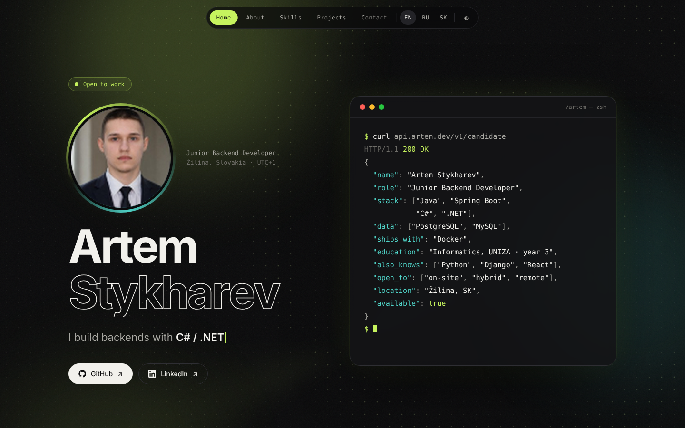

# resume-site

My personal resume page. It's live here:
**https://stykharevengineer.github.io/resume-site/**



I'm a backend developer (Java / Spring Boot and C# / .NET), and I wanted a resume
that's easier to share than a PDF. I also used it as an excuse to practice
React, so it's a small single-page app built with React and Vite rather than
a template from a site builder. No UI libraries, just components and plain CSS.

## What's inside

All the content (contacts, skills, projects, the text in the terminal aside)
lives in `src/data.js`. The components just read from it, so updating the
resume means editing one file and pushing. Treating the content as data and
keeping it out of the markup felt natural coming from the backend side.

Things I added along the way:

- Three languages: English, Russian and Slovak, switchable from the menu.
  The choice ends up in the URL, so
  `https://stykharevengineer.github.io/resume-site/?lang=sk` always opens in
  Slovak. No i18n library; a text field in `data.js` is either a plain string
  or `{ en, ru, sk }`, and a small context picks the right one.
- A fake terminal in the hero that "curls" my profile and prints it as JSON.
- A dot field on a canvas behind everything that ripples and moves away from
  the cursor, plus a few smaller effects: the name rising letter by letter,
  the About text lighting up as you scroll, tilting project cards.
- All animations switch off if your system asks for reduced motion.
- Dark by default, with a light theme in the menu.
- Deploys happen on their own. Every push to `main` runs a GitHub Actions
  workflow that builds the site and publishes it to GitHub Pages.

## Running it locally

You'll need Node 18 or newer.

```bash
npm install
npm run dev
```

Then open http://localhost:5173. `npm run build` puts a production build in `dist/`.

## Project layout

```
public/
  photo.jpg          profile photo
src/
  data.js            resume content in all three languages
  i18n.jsx           language context and interface strings
  motion.js          small hooks for scroll reveal and tilt effects
  index.css          styles and color themes
  App.jsx            puts the sections together
  components/
    Background.jsx   canvas dot field, glow, grain
    Nav.jsx          menu, language switch, theme, scroll progress
    Hero.jsx         photo, name, typewriter line, buttons
    Terminal.jsx     the JSON "API response"
    About.jsx        about text and number tiles
    Skills.jsx       marquee and skill groups
    Projects.jsx
    Education.jsx    university card and languages with a CEFR scale
    Contact.jsx
    Reveal.jsx       fades things in on scroll
    Icon.jsx         inline SVG icons
.github/workflows/
  deploy.yml         build + deploy to GitHub Pages
```

## Other projects

My backend work (Java / Spring Boot, C# / .NET, Django) is in my other
repositories: [github.com/stykharevengineer](https://github.com/stykharevengineer).

## Contact

Email me at main.stykharev@gmail.com, or find me on
[LinkedIn](https://www.linkedin.com/in/artem-stykharev-2b1131388/) and
[Telegram](https://t.me/stykharev).
